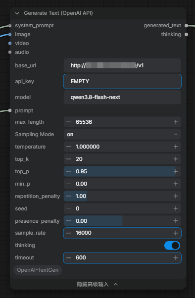

# ComfyUI-OpenAI-TextGen

An API-backed alternative to ComfyUI's local **Generate Text** node. Send text, images, video frames, and audio to an OpenAI-compatible Chat Completions endpoint instead of loading an LLM inside ComfyUI.

Works with hosted OpenAI-compatible APIs and local servers such as vLLM, llama.cpp, and Ollama. The server and model must support each modality you use.

## Features

- **One node for text and multimodal generation** — optional system prompt, image batches, video frames, and audio.
- **OpenAI-compatible endpoint** — calls `{base_url}/chat/completions` with streaming enabled.
- **Flexible sampling** — greedy decoding or configurable standard and vLLM/llama.cpp sampling parameters.
- **Separate reasoning output** — reads structured reasoning fields and inline think markers.
- **Cancellation and progress** — stops on ComfyUI Cancel, closes the connection, and reports approximate streaming progress.
- **No extra Python dependencies** — uses packages already provided by ComfyUI.

## Node Preview



## Installation

1. Clone this repository into your ComfyUI `custom_nodes` folder:

   ```bash
   cd ComfyUI/custom_nodes
   git clone https://github.com/i2cy/ComfyUI-OpenAI-TextGen.git
   ```

2. Restart ComfyUI. No `pip install` step is required.
3. Add **Generate Text (OpenAI API)** from the **text** category. Its node ID is `OpenAITextGenerate`.

This node uses ComfyUI's V3 node API (`comfy_api.latest`); use a ComfyUI version that provides it.

## Quick Start

1. Start or choose an OpenAI-compatible server and note its API root and model name.
2. Set `base_url` to the API root, normally ending in `/v1`. Do not append `/chat/completions`; the node adds that path.
3. Set `model` to a model served by that endpoint. Use an empty `api_key` when the server does not require authentication.
4. Enter a `prompt`, optionally connect a system prompt or media, and run the workflow.

Common API roots:

| Server | Example `base_url` |
| --- | --- |
| vLLM | `http://127.0.0.1:8000/v1` |
| llama.cpp | `http://127.0.0.1:8080/v1` |
| Ollama | `http://127.0.0.1:11434/v1` |
| OpenAI | `https://api.openai.com/v1` |

The built-in defaults target a specific LAN server (`http://192.168.11.104:18300/v1`, model `qwen3.8-flash-next`). Change them unless that server is available on your network.

## Node Reference

### Text and Request Inputs

| Input | Default | Description |
| --- | --- | --- |
| `base_url` | `http://192.168.11.104:18300/v1` | OpenAI-compatible API root. Trailing slashes are handled. |
| `api_key` | `EMPTY` | Sent as a Bearer token when non-empty. Leave blank to omit the `Authorization` header. |
| `model` | `qwen3.8-flash-next` | Model identifier accepted by the server. |
| `prompt` | Empty | User prompt; supports multiline text and dynamic prompts. |
| `system_prompt` | Empty | Optional system-message input socket. |
| `max_length` | `512` | Maximum generated tokens, sent as `max_tokens` (1–131072). |
| `thinking` | `False` | Controls vLLM-style `chat_template_kwargs.thinking`; requires model/server support. |
| `timeout` | `600` | Connect/read timeout in seconds (10–3600). |

### Multimodal Inputs

| Input | Behavior |
| --- | --- |
| `image` | Optional IMAGE batch. Every image is encoded as a PNG data URL and included in the user message. |
| `video` | Optional IMAGE batch. Assumes 24 FPS, subsamples to 1 FPS, then further subsamples when needed to send at most 32 frames. |
| `audio` | Optional AUDIO tensor. Encoded as 16-bit PCM WAV and sent as base64 `input_audio`. |
| `sample_rate` | Sample rate used for the WAV encoding; default `16000` Hz. |

Images and video use `image_url` content parts. Audio uses an `input_audio` content part. Your endpoint must accept these formats; supplying media does not make a text-only model multimodal.

### Sampling

Set `sampling_mode` (**Sampling Mode**) to `off` for greedy decoding. This sends `temperature=0`.

Set it to `on` to configure:

| Parameter | Default | Request behavior |
| --- | --- | --- |
| `temperature` | `0.7` | Always sent. |
| `top_p` | `0.95` | Always sent. |
| `seed` | `0` | Always sent. |
| `presence_penalty` | `0.0` | OpenAI-standard parameter; omitted when `0`. |
| `top_k` | `64` | vLLM/llama.cpp extension; omitted when `0`. |
| `min_p` | `0.0` | vLLM extension; omitted when `0`. |
| `repetition_penalty` | `1.0` | vLLM/llama.cpp extension; omitted when `1.0`. |

Support for extension parameters depends on the server. If it rejects them, set `top_k=0`, `min_p=0`, and `repetition_penalty=1.0`. In particular, some vLLM servers with speculative decoding reject `min_p`.

### Outputs

| Output | Type | Description |
| --- | --- | --- |
| `generated_text` | STRING | Final response content, trimmed of surrounding whitespace. |
| `thinking` | STRING | Reasoning content, trimmed of surrounding whitespace. Empty when the server returns no reasoning. |

Reasoning is read from `reasoning` or `reasoning_content` in streaming deltas and non-streaming response messages. If neither field is present, inline `<|think|>...<|/think|>` markers in the content are split into the two outputs.

## Streaming, Progress, and Cancellation

- Requests use Server-Sent Events (SSE). A regular JSON Chat Completions response is also accepted when a server ignores `stream=true`.
- Queue-card progress is estimated from streamed characters, not exact token counts.
- ComfyUI Cancel is checked before sending and whenever a stream line arrives. On interruption, the HTTP connection is closed so a compatible server can abort generation.
- Cancellation can therefore take until the next streamed line to be observed. ComfyUI Cancel interrupts the current queue item only; clear the queue to discard remaining items.

## Privacy and API Keys

Prompts, system prompts, and connected media are sent to the configured endpoint. Image, video, and audio payloads are base64-encoded in the request. Use an endpoint you trust.

Avoid publishing workflows containing real API keys: the key is a node input and may be saved with the workflow.
